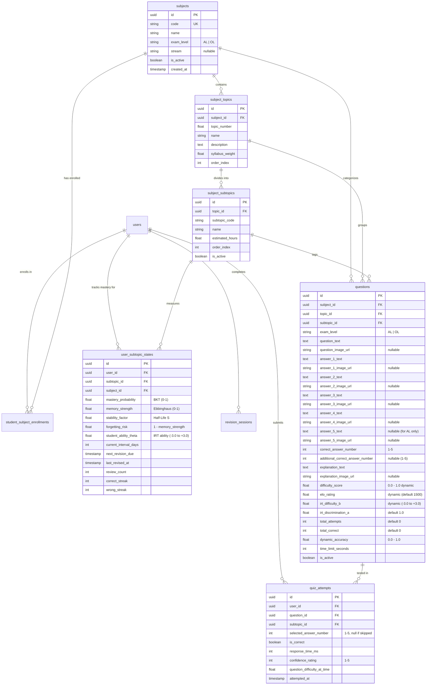
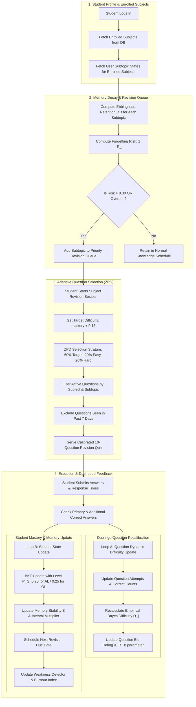

# 🧠 TESO Revision Engine — Comprehensive Implementation Plan

> **Target Service:** `Teso-logics` (FastAPI / SQLAlchemy / Python 3.11+)  
> **Target Frontend:** `Teso` (Next.js 16 / TypeScript / Tailwind CSS)  
> **Architecture Paradigm:** Multi-subject Adaptive Revision Engine with Duolingo-style Dynamic Difficulty Calibration, Spaced Repetition (HLR/Ebbinghaus), and Bayesian Knowledge Tracing (BKT).

---

## 📋 Table of Contents
1. [Executive Summary & Core Objectives](#1-executive-summary--core-objectives)
2. [Database Architecture & Schema Design](#2-database-architecture--schema-design)
   - [2.1 Subject Hierarchy (Subject → Topic → Subtopic)](#21-subject-hierarchy)
   - [2.2 Questions & Dynamic Difficulty Model](#22-questions--dynamic-difficulty-model)
   - [2.3 Student Subject Enrollment & Multi-Subject State](#23-student-subject-enrollment--multi-subject-state)
   - [2.4 Entity Relationship Diagram (Mermaid)](#24-entity-relationship-diagram-mermaid)
   - [2.5 Complete SQLAlchemy Models Implementation](#25-complete-sqlalchemy-models-implementation)
3. [Algorithm Synergy & Interconnection Mapping](#3-algorithm-synergy--interconnection-mapping)
   - [3.1 Algorithm Ecosystem Overview](#31-algorithm-ecosystem-overview)
   - [3.2 Mathematical Formulation & Connections](#32-mathematical-formulation--connections)
   - [3.3 End-to-End Algorithmic Pipeline Diagram](#33-end-to-end-algorithmic-pipeline-diagram)
4. [Duolingo-Style Dynamic Question Difficulty Engine](#4-duolingo-style-dynamic-question-difficulty-engine)
   - [4.1 Dynamic Calibration Math (Birdbrain / IRT / Elo)](#41-dynamic-calibration-math)
   - [4.2 Guessing Parameter Adaptation: A/L (5 options) vs O/L (4 options)](#42-guessing-parameter-adaptation)
   - [4.3 Dual-Correct & Bonus Answer Handling](#43-dual-correct--bonus-answer-handling)
5. [Admin Portal Design (Question Management System)](#5-admin-portal-design)
   - [5.1 UI/UX Architecture & Wireframe Layouts](#51-uiux-architecture--wireframe-layouts)
   - [5.2 Question Authoring Form Specifications](#52-question-authoring-form-specifications)
   - [5.3 Media Upload Strategy (Cloudflare R2 / AWS S3 / Local)](#53-media-upload-strategy)
   - [5.4 Admin API Endpoints Contract](#54-admin-api-endpoints-contract)
6. [Student Multi-Subject Revision Engine Flow](#6-student-multi-subject-revision-engine-flow)
   - [6.1 Subject Selection & Revision Queue Aggregation](#61-subject-selection--revision-queue-aggregation)
   - [6.2 Adaptive Quiz Generation & Session Delivery](#62-adaptive-quiz-generation--session-delivery)
   - [6.3 Real-Time Feedback Loop & Post-Quiz Updates](#63-real-time-feedback-loop--post-quiz-updates)
7. [API Specifications & Pydantic Schemas](#7-api-specifications--pydantic-schemas)
8. [Phased Implementation Roadmap & Checklist](#8-phased-implementation-roadmap--checklist)

---

## 1. Executive Summary & Core Objectives

The existing `Teso-logics` system contains an initial prototype tailored primarily to A/L Chemistry. This plan upgrades the system into a **generalized, multi-subject, multi-level (A/L & O/L) AI revision engine** that dynamically serves questions based on the student's enrolled subjects stored in the database.

### Key Enhancements
1. **Dynamic Multi-Subject Hierarchy**: Normalized relational hierarchy: `Subject` → `SubjectTopic` → `SubjectSubtopic`.
2. **Flexible Answer Formats for Sri Lankan Curricula**:
   - **G.C.E. Advanced Level (A/L)**: 5 answer choices ($P(\text{guess}) = 0.20$).
   - **G.C.E. Ordinary Level (O/L)**: 4 answer choices ($P(\text{guess}) = 0.25$).
   - **Image Support**: Optional images for both question prompts and individual answer choices.
   - **Multi-key Scoring**: Primary correct answer and optional secondary accepted answer (`additional_correct_answer_number`) to reflect official Department of Examinations grading schemes.
3. **Duolingo-Inspired Dynamic Question Difficulty**:
   - Question difficulty is **never static**. It continuously adjusts based on empirical aggregate student accuracy, using a blend of **Empirical Bayes Smoothing**, **Item Response Theory (IRT)**, and **Elo Rating updates**.
4. **Comprehensive Admin Workbench**:
   - High-productivity authoring dashboard for subject educators and moderators to input, preview, and monitor question difficulty analytics.

---

## 2. Database Architecture & Schema Design

### 2.1 Subject Hierarchy
The database decouples subject structures from code:
- **`subjects`**: Represents distinct subjects (e.g., Chemistry, Physics, Combined Mathematics, Biology, Science, History) tagged with `exam_level` (`AL` or `OL`) and `stream` (e.g., `Physical Science`, `Biological Science`, `Commerce`, `General`).
- **`subject_topics`**: High-level syllabus units (e.g., *Unit 01: Atomic Structure*, *Unit 02: Chemical Bonding*).
- **`subject_subtopics`**: Granular learning objectives/skills (e.g., *1.1 Quantum Numbers*, *1.2 Electronegativity*). Each subtopic acts as a node in the knowledge and memory graphs.

### 2.2 Questions & Dynamic Difficulty Model
The `questions` table supports:
- Question stem: text + optional image.
- 5 text choices + 5 optional image choices (`answer_1` to `answer_5`). For O/L questions, `answer_5_text` and `answer_5_image_url` are `NULL`.
- Scoring rules: `correct_answer_number` (1–5) and `additional_correct_answer_number` (nullable 1–5).
- Dynamic metrics:
  - `difficulty_score`: Normalized $0.00 \dots 1.00$ ($0.0 = \text{Trivial}, 1.0 = \text{Extremely Hard}$).
  - `elo_rating`: Dynamic question rating (starts at 1500.0).
  - `irt_difficulty_b`: Latent difficulty parameter $[-3.0, +3.0]$.
  - `irt_discrimination_a`: Item discrimination parameter (default $1.0$).
  - `total_attempts` & `total_correct`: Running cumulative counts.
  - `historical_accuracy`: $\frac{\text{total\_correct}}{\text{total\_attempts}}$ with Bayesian prior smoothing.

### 2.3 Student Subject Enrollment & Multi-Subject State
- `student_subject_enrollments`: Associates each student (`User`) with their active subjects (retrieved from profile settings).
- `user_subtopic_states`: Replaces hardcoded single-subject state tracking with per-student, per-subtopic tracking across all enrolled subjects.

---

### 2.4 Entity Relationship Diagram (Mermaid)



---

### 2.5 Complete SQLAlchemy Models Implementation

Create `app/models/revision_models.py` in `Teso-logics`:

```python
"""
TESO Revision Engine — Comprehensive Relational Models
File: app/models/revision_models.py
"""

import uuid
import enum
from sqlalchemy import (
    Column, String, Integer, Boolean, DateTime, Float,
    ForeignKey, Text, UniqueConstraint, Index, CheckConstraint
)
from sqlalchemy.dialects.postgresql import UUID
from sqlalchemy.sql import func
from app.core.database import Base


class ExamLevel(str, enum.Enum):
    AL = "AL"  # G.C.E. Advanced Level (5 MCQ options)
    OL = "OL"  # G.C.E. Ordinary Level (4 MCQ options)


class Subject(Base):
    __tablename__ = "subjects"

    id = Column(UUID(as_uuid=True), primary_key=True, default=uuid.uuid4)
    code = Column(String(50), unique=True, nullable=False, index=True)
    name = Column(String(150), nullable=False)
    exam_level = Column(String(10), nullable=False, default=ExamLevel.AL.value)
    stream = Column(String(100), nullable=True)  # e.g., 'Physical Science', 'Biology'
    icon_name = Column(String(50), nullable=True)
    is_active = Column(Boolean, default=True, nullable=False)
    created_at = Column(DateTime(timezone=True), server_default=func.now())
    updated_at = Column(DateTime(timezone=True), onupdate=func.now())


class SubjectTopic(Base):
    __tablename__ = "subject_topics"

    id = Column(UUID(as_uuid=True), primary_key=True, default=uuid.uuid4)
    subject_id = Column(UUID(as_uuid=True), ForeignKey("subjects.id", ondelete="CASCADE"), nullable=False)
    topic_number = Column(Float, nullable=False)
    name = Column(String(255), nullable=False)
    description = Column(Text, nullable=True)
    syllabus_weight = Column(Float, default=1.0)
    order_index = Column(Integer, default=0)
    is_active = Column(Boolean, default=True, nullable=False)
    created_at = Column(DateTime(timezone=True), server_default=func.now())
    updated_at = Column(DateTime(timezone=True), onupdate=func.now())

    __table_args__ = (
        Index("ix_subject_topics_subject_order", "subject_id", "order_index"),
    )


class SubjectSubtopic(Base):
    __tablename__ = "subject_subtopics"

    id = Column(UUID(as_uuid=True), primary_key=True, default=uuid.uuid4)
    topic_id = Column(UUID(as_uuid=True), ForeignKey("subject_topics.id", ondelete="CASCADE"), nullable=False)
    subtopic_code = Column(String(50), nullable=False)
    name = Column(String(255), nullable=False)
    description = Column(Text, nullable=True)
    estimated_hours = Column(Float, default=1.0)
    order_index = Column(Integer, default=0)
    is_active = Column(Boolean, default=True, nullable=False)
    created_at = Column(DateTime(timezone=True), server_default=func.now())
    updated_at = Column(DateTime(timezone=True), onupdate=func.now())

    __table_args__ = (
        Index("ix_subtopics_topic_order", "topic_id", "order_index"),
    )


class StudentSubjectEnrollment(Base):
    __tablename__ = "student_subject_enrollments"

    id = Column(UUID(as_uuid=True), primary_key=True, default=uuid.uuid4)
    user_id = Column(UUID(as_uuid=True), ForeignKey("users.id", ondelete="CASCADE"), nullable=False)
    subject_id = Column(UUID(as_uuid=True), ForeignKey("subjects.id", ondelete="CASCADE"), nullable=False)
    enrolled_at = Column(DateTime(timezone=True), server_default=func.now())
    is_primary = Column(Boolean, default=True)

    __table_args__ = (
        UniqueConstraint("user_id", "subject_id", name="uq_user_subject_enrollment"),
        Index("ix_enrollments_user", "user_id"),
    )


class QuestionBank(Base):
    __tablename__ = "question_bank"

    id = Column(UUID(as_uuid=True), primary_key=True, default=uuid.uuid4)
    subject_id = Column(UUID(as_uuid=True), ForeignKey("subjects.id", ondelete="RESTRICT"), nullable=False)
    topic_id = Column(UUID(as_uuid=True), ForeignKey("subject_topics.id", ondelete="RESTRICT"), nullable=False)
    subtopic_id = Column(UUID(as_uuid=True), ForeignKey("subject_subtopics.id", ondelete="RESTRICT"), nullable=False)
    exam_level = Column(String(10), nullable=False, default=ExamLevel.AL.value)

    # Question Prompt
    question_text = Column(Text, nullable=False)
    question_image_url = Column(String(1024), nullable=True)

    # Choices (1 to 5)
    answer_1_text = Column(Text, nullable=True)
    answer_1_image_url = Column(String(1024), nullable=True)

    answer_2_text = Column(Text, nullable=True)
    answer_2_image_url = Column(String(1024), nullable=True)

    answer_3_text = Column(Text, nullable=True)
    answer_3_image_url = Column(String(1024), nullable=True)

    answer_4_text = Column(Text, nullable=True)
    answer_4_image_url = Column(String(1024), nullable=True)

    # 5th choice: Mandatory for AL, Null for OL
    answer_5_text = Column(Text, nullable=True)
    answer_5_image_url = Column(String(1024), nullable=True)

    # Correct Keys (1-indexed: 1, 2, 3, 4, 5)
    correct_answer_number = Column(Integer, nullable=False)
    additional_correct_answer_number = Column(Integer, nullable=True)  # Dual key / bonus

    explanation_text = Column(Text, nullable=True)
    explanation_image_url = Column(String(1024), nullable=True)

    # Dynamic Difficulty & Empirical Metrics (Duolingo / Elo / IRT)
    difficulty_score = Column(Float, default=0.50, nullable=False)      # 0.00 (easy) - 1.00 (hard)
    elo_rating = Column(Float, default=1500.0, nullable=False)           # Dynamic Elo rating
    irt_difficulty_b = Column(Float, default=0.0, nullable=False)        # IRT location parameter b (-3 to +3)
    irt_discrimination_a = Column(Float, default=1.0, nullable=False)    # IRT discrimination parameter a
    total_attempts = Column(Integer, default=0, nullable=False)
    total_correct = Column(Integer, default=0, nullable=False)
    historical_accuracy = Column(Float, default=0.50, nullable=False)

    time_limit_seconds = Column(Integer, default=90, nullable=False)
    is_active = Column(Boolean, default=True, nullable=False)
    created_by = Column(UUID(as_uuid=True), ForeignKey("users.id"), nullable=True)
    created_at = Column(DateTime(timezone=True), server_default=func.now())
    updated_at = Column(DateTime(timezone=True), onupdate=func.now())

    __table_args__ = (
        CheckConstraint("correct_answer_number BETWEEN 1 AND 5", name="chk_correct_answer_range"),
        CheckConstraint(
            "additional_correct_answer_number IS NULL OR additional_correct_answer_number BETWEEN 1 AND 5",
            name="chk_additional_correct_answer_range"
        ),
        CheckConstraint("difficulty_score BETWEEN 0.0 AND 1.0", name="chk_difficulty_score_range"),
        Index("ix_qb_subject_level", "subject_id", "exam_level"),
        Index("ix_qb_subtopic_diff", "subtopic_id", "difficulty_score"),
        Index("ix_qb_active_diff", "is_active", "difficulty_score"),
    )


class UserSubtopicState(Base):
    __tablename__ = "user_subtopic_states"

    id = Column(UUID(as_uuid=True), primary_key=True, default=uuid.uuid4)
    user_id = Column(UUID(as_uuid=True), ForeignKey("users.id", ondelete="CASCADE"), nullable=False)
    subject_id = Column(UUID(as_uuid=True), ForeignKey("subjects.id", ondelete="CASCADE"), nullable=False)
    subtopic_id = Column(UUID(as_uuid=True), ForeignKey("subject_subtopics.id", ondelete="CASCADE"), nullable=False)

    # Core BKT & Retention Parameters
    mastery_probability = Column(Float, default=0.10, nullable=False)    # P(L) Bayesian Knowledge Tracing
    memory_strength = Column(Float, default=1.0, nullable=False)         # R(t) Ebbinghaus retention
    stability_factor = Column(Float, default=1.0, nullable=False)        # Spaced repetition half-life S
    forgetting_risk = Column(Float, default=0.0, nullable=False)         # 1.0 - memory_strength
    student_ability_theta = Column(Float, default=0.0, nullable=False)   # IRT latent ability θ (-3 to +3)

    # Scheduling & Streaks
    current_interval_days = Column(Integer, default=1, nullable=False)
    next_revision_due = Column(DateTime(timezone=True), nullable=True)
    last_revised_at = Column(DateTime(timezone=True), nullable=True)
    review_count = Column(Integer, default=0, nullable=False)
    correct_streak = Column(Integer, default=0, nullable=False)
    wrong_streak = Column(Integer, default=0, nullable=False)

    # Totals
    total_attempts = Column(Integer, default=0, nullable=False)
    total_correct = Column(Integer, default=0, nullable=False)
    avg_response_time_ms = Column(Float, nullable=True)
    is_mastered = Column(Boolean, default=False, nullable=False)
    updated_at = Column(DateTime(timezone=True), onupdate=func.now())

    __table_args__ = (
        UniqueConstraint("user_id", "subtopic_id", name="uq_user_subtopic_state"),
        Index("ix_user_subtopic_due", "user_id", "next_revision_due"),
        Index("ix_user_subject_risk", "user_id", "subject_id", "forgetting_risk"),
    )
```

---

## 3. Algorithm Synergy & Interconnection Mapping

### 3.1 Algorithm Ecosystem Overview
The TESO Revision Engine links 6 foundational algorithms into a unified continuous adaptive cycle:

| Algorithm | Primary Purpose | How It Feeds the Ecosystem |
|---|---|---|
| **1. Duolingo Birdbrain / IRT & Elo** | Computes dynamic question difficulty ($b_j$, $D_j$) & student ability ($\theta_i$) | Feeds calibrated question difficulty into the ZPD Question Selector; updates student ability. |
| **2. Bayesian Knowledge Tracing (BKT)** | Computes subtopic mastery probability $P(L_n)$ per attempt | Triggers mastery status ($\ge 0.85$); informs the target difficulty for the ZPD selector. |
| **3. Spaced Repetition (HLR & SM-2)** | Calculates memory decay $R(t) = e^{-t/S}$ and optimal revision date | Governs the student's dynamic Revision Queue order based on forgetting risk. |
| **4. Vygotsky ZPD Selector** | Assembles the quiz ($60\%$ target difficulty, $20\%$ easier, $20\%$ stretch) | Selects specific questions from enrolled subjects matching student mastery $\theta_i$. |
| **5. Weakness Detector** | Identifies critical skill gaps across enrolled subjects | Injects high-priority corrective items into the revision schedule. |
| **6. Burnout & Fatigue Monitor** | Tracks session duration, pacing, and focus scores | Prevents cognitive overload by recommending breaks or throttling session lengths. |

---

### 3.2 Mathematical Formulation & Connections

```
┌────────────────────────────────────────────────────────────────────────┐
│                        MATHEMATICAL FORMULATIONS                       │
└────────────────────────────────────────────────────────────────────────┘

1. Ebbinghaus & Half-Life Retention (HLR):
   R(t) = exp( - Δt / (S × m_perf) )
   Forgetting Risk = 1.0 - R(t)
   Where:
     - Δt = Days elapsed since last practice
     - S  = Memory stability factor (half-life)
     - m_perf = Performance multiplier:
         Score ≥ 0.90 ➔ ×1.30
         Score ≥ 0.70 ➔ ×1.10
         Score ≥ 0.50 ➔ ×1.00
         Score < 0.50 ➔ ×0.80

2. Bayesian Knowledge Tracing (BKT):
   P(L_n | obs) = 
     If Correct:   [ P(L_n) · (1 - P(S)) ] / [ P(L_n)·(1 - P(S)) + (1 - P(L_n))·P(G) ]
     If Incorrect: [ P(L_n) · P(S) ]       / [ P(L_n)·P(S)       + (1 - P(L_n))·(1 - P(G)) ]
   P(L_n+1) = P(L_n | obs) + (1 - P(L_n | obs)) · P(T)
   Where Guessing probability P(G) adapts dynamically:
     - G.C.E. A/L (5 options): P(G) = 0.20
     - G.C.E. O/L (4 options): P(G) = 0.25

3. Duolingo Dynamic Question Difficulty (Birdbrain Logistic IRT + Elo):
   Predicted Accuracy:
     P(correct | θ_i, b_j) = 1 / ( 1 + exp( - a_j · (θ_i - b_j) ) )
   Question Elo Update:
     ΔElo = K · ( (1 - is_correct) - (1 - P(correct)) )
   Dynamic Empirical Difficulty Score D_j ∈ [0.0, 1.0]:
     D_j = 1.0 - ( total_correct + α ) / ( total_attempts + α + β )
     Where α = 2.0, β = 2.0 (Empirical Bayes prior)
```

---

### 3.3 End-to-End Algorithmic Pipeline Diagram



---

## 4. Duolingo-Style Dynamic Question Difficulty Engine

### 4.1 Dynamic Calibration Math
In standard platforms, a question has a fixed difficulty ("Medium"). In our Duolingo-style engine, every submission shifts the question's difficulty dynamically:

1. **Empirical Bayes Accuracy Rate**:
   To prevent 1 attempt with 0 correct from making a question difficulty $1.0$ instantly, we employ a **Beta-Binomial Conjugate Prior** ($\alpha = 2, \beta = 2$, representing an uninformative prior expectation of $50\%$ accuracy):
   $$\text{Smoothed Accuracy } (\hat{p}) = \frac{\text{total\_correct} + 2}{\text{total\_attempts} + 4}$$
   $$\text{Dynamic Difficulty Score } (D) = 1.0 - \hat{p}$$

2. **Continuous Elo Update**:
   Each question has an `elo_rating` ($R_Q$, base 1500), and each student has an ability rating ($R_S$, derived from student $\theta$).
   Expected student success probability:
   $$E_S = \frac{1}{1 + 10^{(R_Q - R_S)/400}}$$
   Upon answer submission:
   $$R_Q^{\text{new}} = R_Q^{\text{old}} + K \times \left((1 - Y) - (1 - E_S)\right)$$
   Where:
   - $Y = 1$ if correct, $0$ if wrong.
   - $K = 16$ (sensitivity constant).
   If a high-performing student fails the question, the question's Elo rating surges upward.

3. **IRT Latent Parameter Sync**:
   The Item Response Theory parameter $b_j$ is mapped continuously:
   $$b_j = \frac{R_Q - 1500}{200}$$
   Clamped between $[-3.0, +3.0]$.

### 4.2 Guessing Parameter Adaptation: A/L vs O/L
In Sri Lanka's national examinations:
- **A/L MCQ papers** feature **5 options (1, 2, 3, 4, 5)**. Guessing probability $P(G) = \frac{1}{5} = 0.20$.
- **O/L MCQ papers** feature **4 options (1, 2, 3, 4)**. Guessing probability $P(G) = \frac{1}{4} = 0.25$.

The BKT engine detects the question's `exam_level`:
```python
p_guess = 0.20 if question.exam_level == "AL" else 0.25
```
This ensures A/L students do not receive artificially inflated mastery scores from random guesses.

### 4.3 Dual-Correct & Bonus Answer Handling
Official Sri Lankan examination marking schemes frequently award marks for:
- Two distinct valid interpretations (e.g., both option 2 and option 4 accepted).
- Bonus marks / all-correct (indicated by `additional_correct_answer_number = -1`).

**Evaluation Logic**:
```python
def evaluate_answer(selected: int, correct_primary: int, additional: Optional[int]) -> bool:
    if selected is None:
        return False
    if additional == -1:  # All correct / bonus
        return True
    return selected == correct_primary or (additional is not None and selected == additional)
```

---

## 5. Admin Portal Design (Question Management System)

### 5.1 UI/UX Architecture & Wireframe Layouts

The Admin Portal is a dedicated suite located under `/admin/questions` in the Next.js application, accessible only to users with `role: "HOST"` or `role: "ADMIN"`.

```
┌────────────────────────────────────────────────────────────────────────────────────────┐
│  TESO ADMIN — QUESTION MANAGEMENT WORKBENCH                                            │
├────────────────────────────────────────────────────────────────────────────────────────┤
│  Filters: [ Subject: Chemistry ▼ ] [ Level: A/L (5 choices) ▼ ] [ Topic: Unit 2 ▼ ]   │
│  [ Search questions...                                             ]  [ + New Question ]│
├────────────────────────────────────────────────────────────────────────────────────────┤
│  ID    | Topic / Subtopic       | Question Preview       | Accuracy | Diff Score | Actions│
│  #1021 | 2.1 Chemical Bonding   | Which of the following | 42.1%    | 0.58 [Med] | [Edit] │
│  #1022 | 2.3 Hybridization      | [Image: Orbital Diagram| 18.5%    | 0.81 [Hard]| [Edit] │
│  #1023 | 1.4 Electron Config    | Ground state electronic| 88.0%    | 0.12 [Easy]| [Edit] │
└────────────────────────────────────────────────────────────────────────────────────────┘
```

---

### 5.2 Question Authoring Form Specifications

The Authoring Modal/Page `/admin/questions/create` features a dynamic split-pane layout:
- **Left Column**: Authoring inputs.
- **Right Column**: Live Student Preview (renders Markdown, LaTeX equations via KaTeX, and uploaded images exactly as seen on mobile/desktop).

#### Input Fields Specification:
1. **Subject Selector**: Dropdown populated from `/api/admin/subjects`.
2. **Topic Selector**: Populated dynamically based on selected subject.
3. **Subtopic Selector**: Populated dynamically based on selected topic.
4. **Exam Level Toggle**: `A/L` or `O/L`.
   - Selecting `A/L` enables Choice 5 inputs.
   - Selecting `O/L` disables and hides Choice 5.
5. **Question Prompt**:
   - Rich Text Area (supports Markdown & LaTeX `$...$`).
   - Image Upload Box (Drag & Drop or browse, max 5MB, format: JPG/PNG/WebP).
6. **Answer Choices (1 to 4/5)**:
   - Each answer has:
     - Text input (with math support).
     - Optional image upload widget with instant thumbnail preview.
7. **Correct Answer Selector**:
   - Radio button group (Choice 1 to Choice 5) for `correct_answer_number`.
   - Optional Checkbox: "Allow Secondary Correct Answer" → Reveals dropdown for `additional_correct_answer_number` (Choices 1–5 or "Bonus/All Correct").
8. **Explanation & Solution**:
   - Explanation text + optional solution step image.
9. **Benchmark Parameters**:
   - Time limit (seconds, default 90s for A/L, 60s for O/L).
   - Initial seed difficulty band (Easy / Medium / Hard).

---

### 5.3 Media Upload Strategy
To ensure optimal performance and security:
- **Direct-to-Storage Presigned URLs**: The Admin browser requests an upload signature via `POST /api/admin/upload-presigned-url`, uploads the image directly to Cloudflare R2 / AWS S3, and saves the resulting public CDN URL.
- **Image Optimization**: WebP auto-conversion, max dimension $1200\text{px}$, compressed to $< 250\text{KB}$.

---

### 5.4 Admin API Endpoints Contract

The following endpoints will be added to `Teso-logics` under `app/routes/admin_questions.py`:

| Method | Endpoint | Description |
|---|---|---|
| `GET` | `/api/admin/subjects` | List all subjects with topic and question counts |
| `POST` | `/api/admin/subjects` | Create a new subject |
| `GET` | `/api/admin/topics?subject_id={id}` | List topics for a subject |
| `POST` | `/api/admin/topics` | Create a syllabus topic |
| `GET` | `/api/admin/subtopics?topic_id={id}` | List subtopics for a topic |
| `POST` | `/api/admin/subtopics` | Create a subtopic |
| `GET` | `/api/admin/questions` | Paginated question bank search with filters |
| `POST` | `/api/admin/questions` | Create question with 4/5 choices & optional images |
| `GET` | `/api/admin/questions/{id}` | Get full question details with accuracy analytics |
| `PUT` | `/api/admin/questions/{id}` | Update question text, images, answers, or keys |
| `DELETE` | `/api/admin/questions/{id}` | Soft-delete / deactivate question |
| `POST` | `/api/admin/questions/bulk-upload` | JSON / CSV bulk import |
| `GET` | `/api/admin/questions/{id}/analytics`| Real-time difficulty calibration curve & attempt stats |

---

## 6. Student Multi-Subject Revision Engine Flow

### 6.1 Subject Selection & Revision Queue Aggregation

1. When a student navigates to `/revison`:
   - System fetches student's enrolled subjects from `student_subject_enrollments` (e.g., Chemistry, Physics, Combined Mathematics).
   - The UI displays **Subject Tabs** allowing the student to revise:
     - **All Subjects Combined (Smart Mixed Queue)**
     - **Specific Subject (e.g., Physics only)**
2. The Revision Queue Service queries `user_subtopic_states`:
   - Applies Ebbinghaus decay $R(t) = e^{-\Delta t / S}$.
   - Sorts subtopics by urgency:
     $$\text{Priority} = (\text{is\_overdue} \times 10) + \text{forgetting\_risk} \times 5 + (1.0 - \text{mastery\_probability}) \times 2$$
3. Student selects "Start 10-Minute Revision" for the subject.

### 6.2 Adaptive Quiz Generation & Session Delivery

The quiz generation pipeline follows these strict steps:
1. Identify target subtopics from the high-priority queue.
2. Determine student's current ability $\theta_i$ and mastery $P(L_n)$.
3. Calculate target difficulty: $D_{\text{target}} = \min(0.95, P(L_n) + 0.15)$.
4. Apply the **Zone of Proximal Development (ZPD)** ratio:
   - **$60\%$ Target Band**: Questions with $D_j \in [D_{\text{target}} - 0.20, D_{\text{target}} + 0.20]$
   - **$20\%$ Foundation/Easy Band**: Questions with $D_j < D_{\text{target}} - 0.20$
   - **$20\%$ Stretch/Hard Band**: Questions with $D_j > D_{\text{target}} + 0.20$
5. Filter: Only select questions matching the student's `exam_level` (A/L receives 5 options; O/L receives 4 options).
6. Randomize question presentation order and option arrangements.

### 6.3 Real-Time Feedback Loop & Post-Quiz Updates

Upon submitting the quiz attempt via `POST /api/adaptive/quiz/submit`:
1. **Immediate Grading**:
   - Check against `correct_answer_number` or `additional_correct_answer_number`.
2. **Duolingo Recalibration (Async / Immediate)**:
   - Increment question's `total_attempts` and `total_correct`.
   - Update `difficulty_score`, `elo_rating`, and `irt_difficulty_b`.
3. **Student Mastery Update**:
   - Run BKT step with appropriate $P(G)$ (0.20 for AL, 0.25 for OL).
   - Update `memory_strength` and calculate next revision interval using SM-2 multipliers.
4. **Weakness & Burnout Recalibration**:
   - If performance score $< 0.40$, flag subtopic in Weakness Detector.
   - Record response times and interruptions to track fatigue.
5. **Return Rich Response**:
   - Score breakdown, earned XP, updated retention strength, and explanations with step-by-step images.

---

## 7. API Specifications & Pydantic Schemas

Create `app/schemas/revision_schemas.py` in `Teso-logics`:

```python
"""
TESO Revision Engine — Pydantic Schemas
File: app/schemas/revision_schemas.py
"""

from typing import List, Optional
from pydantic import BaseModel, Field, HttpUrl
from datetime import datetime
import uuid


# ─── SUBJECT & TOPIC SCHEMAS ─────────────────────────────────────────────────

class SubjectBase(BaseModel):
    code: str
    name: str
    exam_level: str = "AL"
    stream: Optional[str] = None
    icon_name: Optional[str] = None

class SubjectCreate(SubjectBase):
    pass

class SubjectResponse(SubjectBase):
    id: uuid.UUID
    is_active: bool
    created_at: datetime
    class Config:
        from_attributes = True


class TopicBase(BaseModel):
    subject_id: uuid.UUID
    topic_number: float
    name: str
    description: Optional[str] = None
    syllabus_weight: float = 1.0
    order_index: int = 0

class TopicCreate(TopicBase):
    pass

class TopicResponse(TopicBase):
    id: uuid.UUID
    is_active: bool
    class Config:
        from_attributes = True


class SubtopicBase(BaseModel):
    topic_id: uuid.UUID
    subtopic_code: str
    name: str
    description: Optional[str] = None
    estimated_hours: float = 1.0
    order_index: int = 0

class SubtopicCreate(SubtopicBase):
    pass

class SubtopicResponse(SubtopicBase):
    id: uuid.UUID
    is_active: bool
    class Config:
        from_attributes = True


# ─── QUESTION SCHEMAS ────────────────────────────────────────────────────────

class QuestionCreateRequest(BaseModel):
    subject_id: uuid.UUID
    topic_id: uuid.UUID
    subtopic_id: uuid.UUID
    exam_level: str = Field(..., description="'AL' or 'OL'")
    
    question_text: str
    question_image_url: Optional[str] = None
    
    answer_1_text: Optional[str] = None
    answer_1_image_url: Optional[str] = None
    
    answer_2_text: Optional[str] = None
    answer_2_image_url: Optional[str] = None
    
    answer_3_text: Optional[str] = None
    answer_3_image_url: Optional[str] = None
    
    answer_4_text: Optional[str] = None
    answer_4_image_url: Optional[str] = None
    
    answer_5_text: Optional[str] = Field(None, description="Required for AL, null for OL")
    answer_5_image_url: Optional[str] = None
    
    correct_answer_number: int = Field(..., ge=1, le=5)
    additional_correct_answer_number: Optional[int] = Field(None, ge=1, le=5)
    
    explanation_text: Optional[str] = None
    explanation_image_url: Optional[str] = None
    
    initial_difficulty: Optional[float] = Field(0.50, ge=0.0, le=1.0)
    time_limit_seconds: Optional[int] = 90


class QuestionAdminResponse(BaseModel):
    id: uuid.UUID
    subject_id: uuid.UUID
    topic_id: uuid.UUID
    subtopic_id: uuid.UUID
    exam_level: str
    question_text: str
    question_image_url: Optional[str]
    answer_1_text: Optional[str]
    answer_1_image_url: Optional[str]
    answer_2_text: Optional[str]
    answer_2_image_url: Optional[str]
    answer_3_text: Optional[str]
    answer_3_image_url: Optional[str]
    answer_4_text: Optional[str]
    answer_4_image_url: Optional[str]
    answer_5_text: Optional[str]
    answer_5_image_url: Optional[str]
    correct_answer_number: int
    additional_correct_answer_number: Optional[int]
    explanation_text: Optional[str]
    explanation_image_url: Optional[str]
    difficulty_score: float
    elo_rating: float
    total_attempts: int
    total_correct: int
    historical_accuracy: float
    time_limit_seconds: int
    is_active: bool
    created_at: datetime
    class Config:
        from_attributes = True


# ─── STUDENT REVISION SESSION SCHEMAS ────────────────────────────────────────

class StudentQuestionItem(BaseModel):
    id: uuid.UUID
    subtopic_id: uuid.UUID
    question_text: str
    question_image_url: Optional[str]
    exam_level: str
    choices: List[dict]  # [{'index': 1, 'text': '...', 'image_url': '...'}]
    time_limit_seconds: int

class RevisionSessionResponse(BaseModel):
    session_id: uuid.UUID
    subject_id: uuid.UUID
    subject_name: str
    questions: List[StudentQuestionItem]
    target_difficulty: float
    total_questions: int


class AnswerSubmission(BaseModel):
    question_id: uuid.UUID
    selected_answer_number: Optional[int]  # 1 to 5, None if skipped
    response_time_ms: int
    confidence_rating: Optional[int] = Field(3, ge=1, le=5)

class QuizSessionSubmitRequest(BaseModel):
    session_id: uuid.UUID
    subject_id: uuid.UUID
    answers: List[AnswerSubmission]

class QuestionResultItem(BaseModel):
    question_id: uuid.UUID
    is_correct: bool
    correct_answer_number: int
    additional_correct_answer_number: Optional[int]
    user_selected_number: Optional[int]
    explanation_text: Optional[str]
    explanation_image_url: Optional[str]
    new_question_difficulty: float

class QuizSessionSubmitResponse(BaseModel):
    session_id: uuid.UUID
    total_questions: int
    correct_count: int
    score_percentage: float
    updated_mastery_probability: float
    updated_memory_strength: float
    next_revision_due: datetime
    results: List[QuestionResultItem]
```

---

## 8. Phased Implementation Roadmap & Checklist

### Phase 1: Database Migration & Core Relational Layer
- [ ] Create Alembic migration script in `Teso-logics/alembic/versions/` defining tables:
  - `subjects`
  - `subject_topics`
  - `subject_subtopics`
  - `student_subject_enrollments`
  - `question_bank`
  - `user_subtopic_states`
- [ ] Add check constraints for answer range (`1..5`) and dynamic difficulty ranges (`0.0..1.0`).
- [ ] Write DB seeder script to populate common G.C.E. A/L subjects (Chemistry, Physics, Combined Mathematics, Biology) and O/L subjects (Science, Mathematics).

### Phase 2: Dynamic Question Difficulty & Algorithmic Service Layer
- [ ] Create `app/services/duolingo_difficulty_engine.py`:
  - Empirical Bayes accuracy calculator.
  - Elo rating update system.
  - IRT parameter mapping.
- [ ] Update `app/services/mastery_estimator.py` to accept dynamic $P(G)$ based on `exam_level` (0.20 for AL, 0.25 for OL).
- [ ] Implement dual-key evaluation in `app/services/adaptive_quiz_engine.py`.
- [ ] Create `app/services/multi_subject_revision_service.py` to aggregate queues by student's enrolled subjects.

### Phase 3: Admin Question Workbench & APIs
- [ ] Create `app/routes/admin_questions.py` implementing full CRUD and filtering.
- [ ] Add bulk import endpoint (CSV/JSON) for batch question uploads.
- [ ] Build Next.js Admin UI in `Teso/src/app/admin/questions/`:
  - Subject/Topic/Subtopic cascade selectors.
  - 4/5 option dynamic switch with image upload previews.
  - Primary & secondary correct answer picker.
  - Real-time Markdown & LaTeX math preview.

### Phase 4: Student Revision Experience Integration
- [ ] Update `Teso/src/app/(app)/revison/page.tsx` with Subject filter tabs.
- [ ] Integrate 5-choice (A/L) and 4-choice (O/L) interactive quiz runner.
- [ ] Implement instant post-quiz feedback modal displaying memory retention gains and next review dates.

---
*Document generated as the master specification for TESO Revision Engine integration.*
