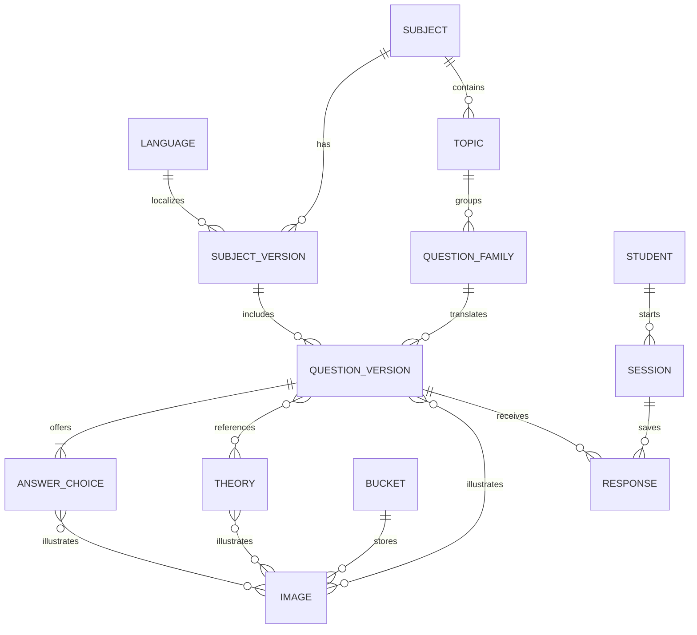

# Multilingual assessment content database

The schema implements one canonical subject and topic hierarchy, with separate language and content versions. Question, answer-choice and theory images reference private bucket objects through ordered link tables. Existing immutable assessment snapshots, student responses and history retain their IDs.

| Purpose | Table | Main columns and relationships |
| --- | --- | --- |
| Subject | `teso_subjects` | `id`, `name` |
| Language | `teso_languages` | `id` (`en`, `si`, `ta`), `name` |
| Subject in a language | `teso_subject_versions` | `id`, `subject_id`, `language_id`, `version`, `display_name`; unique subject/language/version |
| Topic | `teso_topics` | `id`, `subject_id`, `name`; topic IDs map to the existing concepts and retain the unit hierarchy |
| Question across translations | `teso_question_families` | `id`, `subject_id`, `topic_id` |
| Question content version | `teso_question_details` | `id`, `family_id`, `subject_version_id`, `subject_id`, `topic_id`, `language_id`, `version`, `question_text`, `marks`, `primary_theory_id`, `correct_answer_id`, `is_development` |
| Answer choice | `teso_answer_choices` | `id`, `question_id`, `option_id`, `answer_text`; global answer ID plus the original local option label |
| Theory section version | `teso_theories` | `id`, `topic_id`, `language_id`, `version`, `title`, `theory_text`, `url` |
| Question's theory references | `teso_question_theories` | `question_id`, `theory_id`, `topic_id`, `language_id`, `position` |
| Bucket registry | `teso_storage_buckets` | `id`, `provider`, `bucket_name`, `is_private`; deployment currently supports its configured private Supabase bucket |
| Image | `teso_images` | `id`, `bucket_id`, `object_key`, `mime_type`, `role`, `transcription`, `sha256`, `byte_size` |
| Question/solution images | `teso_question_images` | `question_id`, `image_id`, `role`, `position` |
| Answer images | `teso_answer_choice_images` | `answer_id`, `image_id`, `role`, `position` |
| Theory images | `teso_theory_images` | `theory_id`, `image_id`, `role`, `position` |



## Why these relationships

One subject remains the same subject across languages. The English, Sinhala and Tamil versions have separate subject-version rows. An author supplies the same `family_id` for translations or later versions of the same underlying question; each actual question version still has its own immutable ID. A family cannot cross topics or subjects, and a family/language/version combination is unique.

Foreign keys ensure a question's subject, topic, subject language version, theory and correct answer agree. The correct answer must belong to that question. A question can reference multiple theory sections, and every theory link must have the same topic and language. `primary_theory_id` is the first ordered reference, retained for simple lookups.

`teso_answer_choices` contains content choices. Existing `teso_answers` contains a student's selected option, final correctness, marks, timestamps and optional duration/exposure evidence. These remain separate because many students answer the same question. Existing `teso_sessions`, `teso_presented`, `teso_learning_records`, and `teso_session_plans` retain paper history and adaptation provenance.

Images stay in object storage; the database stores bucket/object references, not image binaries, credentials, or expiring signed URLs. Multiple ordered image links replace a single image column. Image roles prevent a theory or solution image from being attached as pre-submission question content. The bucket registry declares the required privacy policy; actual bucket privacy is verified when fetching images. Registering a row does not provision a cloud bucket.

New imports calculate image checksums from verified bytes. Migration leaves legacy checksums unknown until an explicit validated import supplies bytes. Thereafter, changed bytes are rejected during import and image serving; the worker does not send changed bytes to an AI model. Questions/options are accessible during an owned assessment; solutions and theory images are available only after submission.

## Content import

The existing package format is compatible. Optional new fields are:

```json
{
  "question": {"id": "force-si-v1", "family_id": "force-example", "language": "si", "version": 1},
  "resource": {"id": "force-theory-si-v1", "language": "si", "media_ids": ["force-theory-diagram"]},
  "media": {"id": "force-theory-diagram", "bucket_id": "teso-assessments", "object_key": "approved/force-theory.png", "mime_type": "image/png", "role": "theory"},
  "paper": {"content_language": "si", "subject_version": 1}
}
```

This is a field illustration, not a complete import package. Full packages still supply reviewed question text/options/key, resources, subjects/units/concepts, and paper membership. Imports preserve immutable JSON grading snapshots and write normalized rows in the same transaction. Missing language defaults to the paper's content language; legacy question families default to that version's own ID. Migration does not guess translation families from question names. Authors must supply explicit families for cross-language grouping and leakage-resistant evaluation splits.

## Efficient ML preparation

Relational columns and indexes support subject/topic/language selection, family grouping, and student-history ordering without parsing large JSON blobs. Correctness and awarded marks are persisted from deterministic grading. Topic score calculations use sums of awarded/possible marks rather than AI-generated grades.

The server-only `dataset.training_records` exporter issues two selected-column queries and buffers one student's history at a time. Each JSONL record separates:

- **Features:** subject/topic/language, question family/version, possible marks, counts of prior topic outcomes, prior family exposure, and time since prior topic evidence.
- **Labels:** current correctness (nullable for unanswered), outcome, awarded marks.
- **Metadata:** session/question IDs, times, activity type, development status, known assistance flags, and observed duration.

Features use only outcomes submitted strictly before the target assessment started. Exposure uses earlier presented-membership snapshots, including unfinished sessions; this records presentation, not confirmed reading. Overlapping assessments cannot contribute future labels. Sessions containing duplicate families are excluded. Default training examples are independent assessments with no earlier family presentation or known assistance. Development students, sessions and content are excluded by default.

Student IDs are HMAC-pseudonymized with a separate random `ML_EXPORT_SALT` of at least 32 characters. The exporter fetches no names, emails, answer keys, selected options, theory, explanation text or image paths. Keep labels/metadata out of prediction inputs, and evaluate with held-out students, time periods and question families to avoid learning repeated versions of the same question. Unknown hint/exposure telemetry remains unknown; no false values are invented.

No model is trained or real student dataset exported automatically. To opt into an offline export after configuring `ML_EXPORT_SALT` in the ignored Python environment:

```powershell
cd Agentic
.\.venv\Scripts\python.exe -m app.assessment.cli export-training --output exports/training.jsonl
```

`--include-development` is an explicit synthetic-data option. Exports do not overwrite an existing file, failed partial exports are removed, and `Agentic/exports/` is ignored by Git.

## Migration and checks

Migration 003 is documented in `Agentic/migrations/003_multilingual_content.sql`. The canonical command creates the new tables, indexes and private grants and backfills the catalog transactionally:

```powershell
cd Agentic
.\.venv\Scripts\python.exe -m app.assessment.cli migrate
```

Migrations use `DATABASE_URL_UNPOOLED` when configured, or the same Neon endpoint without its pooling suffix. Existing content IDs, grading JSON, responses and history are preserved. Ambiguous legacy language metadata or orphan questions abort backfill rather than inventing mappings. Test migrations on an isolated database branch before applying them to production.

`scripts/verify_catalog_migration.py` applies the migration and checks baseline content/final responses/history, printing only preservation status and aggregate catalog counts. Automated tests use temporary databases and mocked media/providers; they cover migration preservation, foreign keys, translations, image permissions/integrity, temporal feature boundaries, pseudonymization, exposure filters and safe exports.
